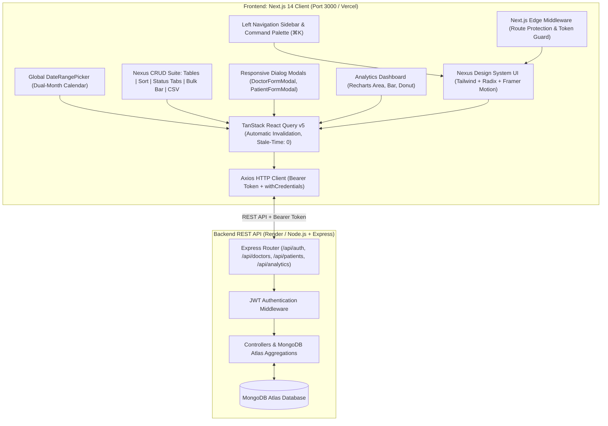

# Doctor Tracker — Clinical Management Portal (Frontend)

[](https://nextjs.org/)
[](https://react.dev/)
[](https://www.typescriptlang.org/)
[](https://tailwindcss.com/)
[](https://tanstack.com/query/latest)
[](https://www.framer.com/motion/)
[](https://vercel.com/)

A secure, high-performance administrative web application for healthcare administrators to seamlessly manage doctors, their associated patient rosters, and department analytics. Built with an elegant design system ported directly from **Nexus**, the portal delivers fluid UX, real-time data visualization, universal clinical search, and end-to-end type safety.

> 🔗 **Backend Repository**: [DoctorTracker-Backend](https://github.com/AB-Kayes/DoctorTracker-Backend) (Node.js, Express, TypeScript, MongoDB Atlas)

---

## 1. Description & Elevator Pitch

**Doctor Tracker** empowers clinical administrators to effortlessly oversee medical practitioners, monitor patient intake and clinical status, and track department caseloads in real time. Combining an intuitive administrative dashboard with MongoDB Atlas aggregation pipelines, responsive dialog workflows, and instant CSV reporting, Doctor Tracker eliminates administrative bottlenecks and optimizes healthcare operations with sub-100ms response times.

---

## 2. Key Features & Nexus Design System

### 🎨 Nexus Design System & UX
- **Warm Layered Neutrals & Healthcare Teal**: Warm surface palette (`#FBF9F4` / `#EDE8DF`) with clinical teal primary accents (`#0D9488` / `#0284C7`), subtle card shadows, and dark mode support.
- **Geist Typography**: Uses Geist Variable and Geist Mono Variable for clean legibility across metric headers and data grids.
- **Hydration-Safe One-Click Theme Switcher**: Sun/Moon toggle positioned in the top header and command palette using `resolvedTheme` to guarantee instantaneous single-click switching from system dark mode.
- **Fixed Left Navigation Sidebar**: Collapsible desktop sidebar with live dynamic badge counters and responsive mobile drawer backdrop.

### 🔍 Universal Command Palette (`⌘K` / `Ctrl+K`)
- Instant real-time clinical search across doctors and patients in parallel.
- Deep-linking search sync: Clicking any patient fills their name into the clinical registry search bar, resets conflicting filter tabs, and isolates the intended patient with a one-click clear button.
- Keyboard navigation shortcuts (`G D` for Dashboard, `G O` for Doctors, `G P` for Patients) and quick creation modal triggers.

### 📅 Global Date Range Picker & Interactive Calendar
- Dual-month calendar popover with presets (`Today`, `Yesterday`, `Last 7 days`, `Last 30 days`, `Last 90 days`, `Year to date`, `All time`, `Custom range`).
- Drives real-time dashboard analytics: dynamically recalculates total patients, doctor caseload ratios, admissions timelines, and dynamic month-over-month trend comparison badges relative to the selected time window.

### 📋 Comprehensive Nexus CRUD Suite
- **Debounced Multi-Field Search**: Server-side text search across names, specializations, hospitals, conditions, and phone numbers.
- **Interactive Column Sorting**: Clickable table headers with Asc/Desc toggle arrows.
- **Status Filter Tabs**: Filter tabs with real-time item count chips (`All`, `Admitted`, `Outpatient`, `Discharged`).
- **Multi-Select & Floating Bulk Action Bar**: Select individual or all records with bulk delete, bulk status updates, and bulk CSV export.
- **Instant Client-Side CSV Export**: Generates compliant RFC-4180 CSV downloads directly in the browser.
- **Responsive Dialog Modals**: Fluid Create & Edit dialogs for doctors and patients with real-time validation and field error indicators.
- **Doctor Profile Caseload Roster**: Dedicated physician profile view with credential headers, caseload statistics, and integrated patient roster with direct assignment controls.

---

## 3. System Architecture

The frontend communicates with the decoupled REST API via Axios and TanStack React Query v5, with dual authentication support (HTTP-only cookies + Authorization Bearer header fallback for seamless cross-origin deployment).



---

## 4. Technical Decisions Deep Dive

### Decision 1: TanStack React Query v5 + Axios over Global State (Redux / Context API)
- **Rationale**: The state in Doctor Tracker consists predominantly of *server state* (doctors directory, patient records, status tab counts, analytical metrics) rather than transient UI state.
- **Benefits**:
  - **Automatic Cache Invalidation**: Mutations (`create`, `update`, `delete`, `bulkUpdate`) trigger coordinated invalidations (`doctors`, `patients`, `analytics-overview`), keeping all views in sync without manual dispatchers or prop drilling.
  - **Pagination Caching & Optimistic Feel**: Cached pages display instantly when navigating backward and forward.
  - **Elimination of Redux Boilerplate**: Replaces hundreds of lines of actions, reducers, and thunks with clean declarative `useQuery` and `useMutation` hooks.

### Decision 2: Dual Cross-Origin Authentication (Edge Cookie + Bearer Fallback)
- **Rationale**: When deployed across two different cloud domains (Vercel at `*.vercel.app` and Render at `*.onrender.com`), browsers partition or restrict third-party cross-site cookies.
- **Benefits**:
  - **Edge Middleware Protection**: Next.js Edge Middleware (`middleware.ts`) reads `document.cookie` on the Vercel domain to gate access before rendering.
  - **Bearer Token Interceptor**: Axios injects `Authorization: Bearer <token>` from `localStorage` into all API calls, guaranteeing uninterrupted authenticated requests on Safari, Chrome, and Brave without third-party cookie blocks.

---

## 5. Visual Evidence

| View / Screen | Platform | Description | Key Features Demonstrated |
| :--- | :--- | :--- | :--- |
| **Administrative Dashboard** | Desktop & Mobile | Real-time clinical intelligence and operational health monitor | Top 4 StatCards with dynamic MoM trends, Admissions Timeline Area Chart (gradient fill), Specialization Bar Chart, Status Donut Chart, and recent activity tables. |
| **Doctor Management Directory** | Desktop | Comprehensive directory of hospital practitioners | Debounced search, specialization filter dropdown, date-range picker, sortable column headers, multi-select checkboxes, floating Bulk Action Bar, CSV export. |
| **Doctor Profile & Caseload Roster** | Desktop & Mobile | In-depth physician caseload breakdown (`/doctors/[id]`) | Credential header, active caseload statistics, integrated patient table with direct "Add Patient under Doctor" modal (doctor locked) and unassign action. |
| **Patient Clinical Registry** | Desktop & Mobile | Dedicated patient intake and clinical status tracker | Status filter tabs (`All`, `Admitted`, `Outpatient`, `Discharged`) with live count chips, condition filter, doctor filter, bulk status update, bulk delete, and CSV export. |
| **Responsive Modals** | Desktop & Mobile | Nexus-style dialog workflows | Add Doctor and Admit Patient dialogs with real-time Zod validation, error indicators, and themed scrollable viewports. |
| **Universal Command Palette (⌘K)** | Desktop & Mobile | Global keyboard search & deep-link navigator | Parallel real-time doctor & patient search; clicking a patient redirects to `/patients?search=...`, resets conflicting tabs, and isolates the target record. |
| **One-Click Theme Switcher** | Desktop & Mobile | Seamless light/dark mode adaptation | Hydration-safe theme toggle using `resolvedTheme` to guarantee instantaneous switching from system dark mode on a single click. |

---

## 6. Directory Structure

```text
DoctorTracker-Frontend/
├── public/                 # Static assets & icons
├── src/
│   ├── app/                # Next.js 14 App Router
│   │   ├── (auth)/         # Guest auth layouts (/login, /register)
│   │   ├── (dashboard)/    # Authenticated views
│   │   │   ├── doctors/    # Directory & [id] profile roster
│   │   │   ├── patients/   # Clinical patient registry
│   │   │   └── page.tsx    # Analytics dashboard overview
│   │   ├── globals.css     # Nexus design tokens & Tailwind theme
│   │   ├── layout.tsx      # Root layout & font injection
│   │   └── providers.tsx   # QueryClient & ThemeProvider
│   ├── components/
│   │   ├── brand/          # SVG logo & badges
│   │   ├── dashboard/      # Recharts visualizations & metric cards
│   │   ├── doctors/        # Doctor tables & form modals
│   │   ├── layout/         # Fixed Sidebar & TopHeader
│   │   ├── nexus/          # Nexus component library (date-picker, stat-cards, cmdk)
│   │   ├── patients/       # Patient tables & admission modals
│   │   └── ui/             # Radix primitives (dialog, popover, calendar, select)
│   ├── hooks/              # Custom hooks (use-debounce, use-mobile)
│   ├── lib/                # Axios API client, motion variants, CSV export
│   ├── services/           # Typed API service layer (auth, doctor, patient, analytics)
│   ├── types/              # TypeScript interfaces (IDoctor, IPatient, IUser, etc.)
│   └── middleware.ts       # Edge route protection & redirect guard
├── .env.example            # Environment template
├── next.config.mjs         # Next.js configuration & rewrites
├── tailwind.config.ts      # Tailwind color tokens & typography
└── tsconfig.json           # TypeScript configuration
```

---

## 7. Quick Start Guide

### Prerequisites
- **Node.js**: v18.0.0 or higher (v20+ recommended)
- **npm**: v9.x or higher
- **Running Backend**: Local backend on `http://localhost:5001` or deployed Render backend

---

### Step 1: Clone the Repository
```bash
git clone https://github.com/AB-Kayes/DoctorTracker-Frontend.git
cd DoctorTracker-Frontend
```

---

### Step 2: Install Dependencies
```bash
npm install
```

---

### Step 3: Configure Environment Variables
Copy `.env.example` to `.env.local`:
```bash
cp .env.example .env.local
```

Edit `.env.local`:
```env
# Point to your local or deployed backend (must include /api)
NEXT_PUBLIC_API_URL=http://localhost:5001/api
```

---

### Step 4: Run Development Server
```bash
npm run dev
```

Open [http://localhost:3000](http://localhost:3000) in your browser.

#### Default Admin Credentials (from Database Seed)
- **Email**: `admin@doctortracker.com`
- **Password**: `admin123`
*(Pre-filled on the login screen for instant access)*

---

### Step 5: Production Build & Linting
```bash
# Type check and build optimized bundle
npm run build

# Start production server
npm run start

# Run ESLint
npm run lint
```

---

## 8. Deployment to Vercel

1. Import your `DoctorTracker-Frontend` repository into [Vercel](https://vercel.com/).
2. Framework preset: **Next.js** (detected automatically).
3. Add the environment variable:
   - **Key**: `NEXT_PUBLIC_API_URL`
   - **Value**: `https://<your-backend-name>.onrender.com/api`
4. Click **Deploy**.
5. Once deployed, ensure your Render backend has `FRONTEND_URL` configured with your live Vercel domain (`https://<your-app>.vercel.app`) to authorize CORS and credentials exchange.

---

## 9. License

This project is open-source and available under the [ISC License](LICENSE).
